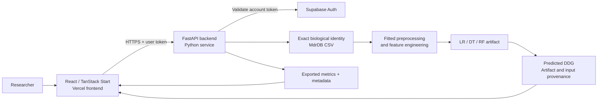

# OncoBind-ML

### Mutation-induced protein-drug binding affinity research

OncoBind-ML is a research application for estimating changes in protein-drug binding affinity (DDG) using molecular descriptors and trained regression models. It combines a biological-input interface, authenticated FastAPI inference, and a live evaluation dashboard.

**Research prototype:** predictions are model estimates. The application is not clinically validated and does not recommend treatment.

[Quick start](#quick-start) | [Model evaluation](#model-evaluation) | [Architecture](#architecture) | [Vercel deployment](docs/DEPLOYMENT.md) | [Research methodology](research/methodology.md) | [Backend reference](backend/README.md)

## What works today

| Capability | Current implementation |
| --- | --- |
| Biological inputs | UniProt/PDB ID, mutation, and PubChem CID or exact dataset SMILES |
| Descriptor preparation | Exact-record retrieval of precomputed MdrDB descriptors; optional PDB/chain/sample selection |
| Inference | Nine fitted models: LR, DT, and RF, each with tiers A, B, and C |
| Authentication | Supabase email signup/login; backend token validation protects prediction and sample routes |
| Dashboard | Live dataset statistics, model readiness, feature schemas, and exported evaluation metrics |
| Reproducibility | Fitted preprocessing, ordered feature lists, dataset/test-split hashes, and artifact versions |
| Frontend hosting | TanStack Start SSR configured for Vercel through Nitro |
| XGBoost | Awaiting a compatible trained export |
| New molecular combinations | De novo structure preparation, PLIP, docking, and descriptor generation are **not implemented** |

The primary form does not ask users to enter 146 values manually. When the input identifies a record in the supplied dataset, the backend retrieves its descriptors and runs the model. This is **not a new docking calculation**. Unknown combinations return an explanatory error instead of guessed descriptors. An advanced descriptor editor remains available for measured inputs.

## Architecture



The Python backend must be reachable over HTTPS in production. Deploying the frontend to Vercel alone does not start FastAPI or provide its dataset/model files. Supabase stores user accounts; it is not used to host the training CSV.

## Repository layout

```text
OncoBind-ML/
|-- frontend/                 React, TanStack Start, Tailwind CSS, Supabase client
|   |-- src/components/       Landing page, dashboard, biological prediction console
|   |-- src/routes/           Homepage and authentication routes
|   |-- public/               Images and public assets
|   |-- .env.example          Public frontend configuration template
|   `-- vercel.json           Vercel framework and build configuration
|-- backend/
|   |-- app/api/              Authentication, prediction, models, dashboard APIs
|   |-- app/schemas/          Validated request and response contracts
|   |-- app/services/         Identity resolution, preprocessing, model loading
|   |-- app/core/             Configuration and token validation
|   |-- training/             Notebook runners, practical training, export, reporting
|   `-- Dockerfile            Container for the Python inference service
|-- models/                   Algorithm/tier artifacts, metrics, schemas, metadata
|-- data/                     Raw MdrDB CSV, processed tiers, example inputs
|-- notebooks/                Uploaded research notebooks
|-- results/                  Evaluation tables, predictions, plots, training reports
|-- research/                 Methodology and references
|-- database/                 Authentication configuration notes
|-- tests/                    API, authentication, inference and integration tests
|-- docs/                     Deployment and GitHub publication guides
`-- .github/workflows/        Automated frontend and backend checks
```

## Quick start

### Prerequisites

- Node.js **24.x** and npm; `frontend/package-lock.json` is the npm lockfile.
- Python **3.13** for the currently exported artifacts.
- Git LFS for the large CSV and model files, or equivalent local artifact provisioning.
- A Supabase project with email/password authentication configured.

The dependency versions recorded with the supplied models are in [requirements-trained.txt](backend/requirements-trained.txt). Preserve compatible scikit-learn/joblib versions when loading these artifacts.

### 1. Obtain the research assets

After cloning this repository:

```sh
git lfs install
git lfs pull
```

Ensure `data/raw/MdrDB_Full_Scraped.csv` and the nine `models/<algorithm>/model_<A|B|C>/model.joblib` files contain the actual data, not Git LFS pointer text. See [publishing and large files](docs/GITHUB.md) if this is your first push.

### 2. Configure the backend

From the repository root in PowerShell:

```powershell
py -3.13 -m venv venv
.\venv\Scripts\python.exe -m pip install -r backend/requirements-inference.txt
Copy-Item .env.example .env
```

On Linux/macOS, use `python3.13 -m venv venv`, `venv/bin/python -m pip install -r backend/requirements-inference.txt`, and `cp .env.example .env`.

Edit `.env` with your actual Supabase project URL and publishable key. The restricted auth gateway also supports a server-only `SUPABASE_SECRET_KEY` if a publishable key is unavailable. Never put a secret/service-role key in a `VITE_` variable. If `.env` already exists, edit it rather than overwriting it.

```powershell
.\venv\Scripts\python.exe -m uvicorn backend.app.main:app --reload
```

API: `http://127.0.0.1:8000` | OpenAPI documentation: `http://127.0.0.1:8000/docs`

### 3. Start the frontend

In a second terminal:

```powershell
cd frontend
npm ci
Copy-Item .env.example .env.local
npm run dev -- --port 3000
```

On Linux/macOS, replace `Copy-Item` with `cp`. Preserve existing `.env.local` settings if already configured.

Open `http://localhost:3000`. The example configuration uses the backend's restricted authentication gateway. In Supabase Auth URL Configuration, add the local application URL as an allowed redirect and set the appropriate Site URL. Confirm your email if the project requires email confirmation.

### 4. Run a prediction

1. Sign in and open the biological prediction console.
2. Select a ready model, or keep RF / Tier A.
3. Choose **Load dataset example**, then **Predict DDG**.
4. Alternatively, enter a protein ID, mutation, and PubChem CID/SMILES. Select a specific sample if multiple structures match.

The result separates the model prediction from the recorded experimental DDG. Both use the MdrDB target units, kcal/mol. A record in the source dataset may have participated in model fitting; its prediction is not independent evidence of generalization.

## Model evaluation

The supplied artifacts use the **practical-v1** training profile: bounded tuning followed by a seeded random-row holdout. This profile is not the original notebooks' exhaustive parameter search.

- Dataset: **100,537 rows**, **168 columns**; target `DDG.EXP`.
- Development set: **80,429 rows**; locked test set: **20,108 rows**; seed **42**.
- Raw feature tiers: **A = 51**, **B = 57**, **C = 146** descriptors.
- Tier B/C preprocessing includes algorithm-specific engineered features; these are computed inside the saved predictor.

| Algorithm | Tier | R2 | RMSE | MAE |
| --- | --- | ---: | ---: | ---: |
| Linear regression | A | 0.1167 | 1.0315 | 0.7483 |
| Linear regression | B | 0.1161 | 1.0319 | 0.7480 |
| Linear regression | C | 0.1184 | 1.0305 | 0.7470 |
| Decision tree | A | 0.8012 | 0.4893 | 0.2240 |
| Decision tree | B | 0.7983 | 0.4929 | 0.2249 |
| Decision tree | C | 0.8365 | 0.4437 | 0.1750 |
| Random forest | A | 0.8979 | 0.3507 | 0.1842 |
| Random forest | B | 0.8964 | 0.3533 | 0.1864 |
| Random forest | C | 0.8930 | 0.3590 | 0.1774 |


Scores are transcribed from [all_models_comparison.csv](results/final/all_models_comparison.csv). The application itself reads each artifact's `metrics.json` and `metadata.json`, and groups comparisons by dataset/test-split hashes. See [evaluation report](results/final/model_evaluation.md) and [comparison plots](results/plots/comparison/).

**Interpretation:** random-row performance does not establish accuracy on unseen proteins, drugs, or scaffolds. Protein/drug-grouped validation, external validation, and calibrated uncertainty remain future work. No model score guarantees an exact experimental DDG for an individual sample.

## Reproduce and verify

Install development/training dependencies:

```powershell
.\venv\Scripts\python.exe -m pip install -r backend/requirements-training.txt -c backend/requirements-trained.txt
.\venv\Scripts\python.exe -m pytest tests -q
.\venv\Scripts\python.exe -m backend.training.verify
```

The regular tests use temporary fixtures. The final command requires the real exported artifacts and reference prediction CSVs; it compares real inference outputs while mocking Supabase user validation. It does not test a real user's login or create an account.

```powershell
cd frontend
npm run typecheck
npm run build
```

Training commands, export contracts, and the difference between practical and full notebook runs are described in the [backend guide](backend/README.md). Training is an offline workflow and does not run during Vercel builds or prediction requests.

## API overview

| Method and path | Access | Purpose |
| --- | --- | --- |
| `GET /api/health` | Public | Process liveness |
| `GET /api/dashboard` | Public | Dataset summary, validated model catalog, metrics and provenance |
| `GET /api/models` | Public | Ordered feature schemas and model status |
| `GET /api/analytics` | Public | Exported finite evaluation scores |
| `GET /api/biological/example` | Signed in | Existing biological identity example |
| `POST /api/predict/biological` | Signed in | Exact-identity descriptor resolution and model inference |
| `POST /api/predict` | Signed in | Advanced measured-descriptor inference |
| `GET /api/models/{algorithm}/{variant}/sample` | Signed in | Exported numeric example |
| `/auth/v1/...` | Route-dependent | Restricted email signup, login, refresh, user and logout gateway |

Prediction requests use `Authorization: Bearer <user-access-token>`. Invalid credentials return 401, stale model versions or ambiguous records return 409, invalid/unavailable biological inputs return 422, and unavailable artifacts/services return 503. All-null descriptor inputs are rejected.

## Deployment

Use **Vercel for the frontend**, a separately hosted **Python API with the model/data files**, and **Supabase Auth**. The [deployment guide](docs/DEPLOYMENT.md) includes:

- Vercel root directory, build target, Node version, and environment variables.
- Backend Docker commands and required artifacts.
- Supabase redirect URLs, CORS, and email confirmation configuration.
- Production smoke checks and common deployment errors.

No deployment URL is claimed here until the project is deployed and verified. Actual credentials belong in the hosting provider's environment settings, not in Git.

## Research provenance and attribution

The source dataset and descriptor methodology are from **MdrDB**, not generated originally by this application. Cite the dataset authors when using it:

> Yang et al. (2023). *A mutation-induced drug resistance database (MdrDB).* Communications Chemistry, 6, 123. [DOI: 10.1038/s42004-023-00920-7](https://doi.org/10.1038/s42004-023-00920-7).

[MdrDB source repository](https://github.com/tencent-quantum-lab/MdrDB) contains the upstream research context. The protein-ligand hero image is a conceptual illustration, not the experimental structure of the submitted protein. The frontend was initially scaffolded with Lovable and uses React, TanStack Start, and Tailwind CSS.

## Contributing and licensing

For changes to inference or training, include the feature contract, preprocessing changes, validation method, and reproducible results. Keep generated scores separate from illustrative content. Report software errors with model/tier, input identifiers, and the response status; do not include passwords or tokens.

A project-wide software license has not yet been selected. Public availability does not imply unrestricted reuse. Dataset, publications, libraries, and other third-party assets retain their own terms; verify those before redistribution or publication.
# AI-MLproject

