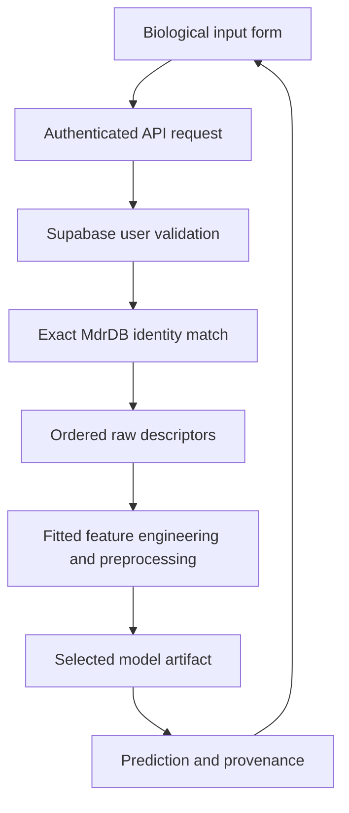

# Project guide

This repository separates the running application from the experiments and their outputs. Start here when explaining the code to a reviewer.

## Where to find things

| Area | Responsibility | Entry point |
| --- | --- | --- |
| Frontend routes | URL definitions, page metadata and page composition | [`index.tsx`](../frontend/src/routes/index.tsx) |
| Authentication UI | Login/signup and the active session hook | [`features/auth/`](../frontend/src/features/auth/) |
| Landing page | Hero illustration, headline and research scope | [`features/landing/`](../frontend/src/features/landing/) |
| Model catalog | Algorithms and feature tiers | [`features/catalog/`](../frontend/src/features/catalog/) |
| Dashboard | Shared live API state and evaluation tables | [`features/dashboard/`](../frontend/src/features/dashboard/) |
| Prediction UI | Authenticated biological and advanced descriptor consoles | [`features/prediction/`](../frontend/src/features/prediction/) |
| Shared UI | Layout, animation and reusable UI primitives | [`components/`](../frontend/src/components/) |
| Backend API | HTTP routes and authentication boundary | [`main.py`](../backend/app/main.py) |
| Backend schemas | Input validation and response contracts | [`schemas/`](../backend/app/schemas/) |
| Inference services | Identity resolution, ordered inputs and model prediction | [`services/`](../backend/app/services/) |
| Offline training | Train, export, report and verify | [`training/`](../backend/training/) |
| Tests | Unit checks, API tests and notebook export integration | [`tests/`](../tests/) |
| Presentation | Demo checklist, example input and talk outline | [`presentation/`](../presentation/) |

## Boundaries to preserve

- Routes compose feature components; Supabase-specific adapters stay in `integrations/supabase/`.
- Shared `components/ui/` primitives do not own scientific rules or model scores.
- `backend/app/` serves requests; `backend/training/` runs offline jobs. Training is not triggered by a prediction request.
- `data/raw/` is source data, `data/processed/` is derived training input, `models/` is the serving artifact registry, and `results/` contains experiment outputs.
- `backend.app.services.notebook_model.NotebookModel` is referenced by saved joblib objects. Changing this import path requires an artifact compatibility/migration plan. It remains stable here.
- Vercel's project root remains `frontend`. Existing Python module commands and artifact paths remain valid.

## Request flow



An absent exact match is an explicit unsupported-input response, not a fabricated descriptor vector. The experimental DDG is shown separately and never used as a predictor input.

## Daily workflow

Run from the repository root after installing dependencies:

```sh
python scripts/project.py doctor
python scripts/project.py backend
```

In another terminal:

```sh
python scripts/project.py frontend
```

Other commands: `test` runs pytest; `check` adds frontend type checks and deployment configuration tests; `build` creates the Vercel frontend output; `verify-models` runs real artifact parity checks with mocked auth. The runner selects the existing project `venv` when present. `doctor` reads no credential values and checks local file availability only.

## Adding work

| Change | Location | Required validation |
| --- | --- | --- |
| New screen or interaction | Appropriate frontend feature + route if needed | Typecheck/build; review the interaction |
| New API behavior | Route, schema, service | Integration test for the request and failures |
| Pure preprocessing logic | Inference service | Unit test and notebook/artifact parity |
| New trained model | Offline training + full artifact set | Held-out metrics, metadata hashes, export parity |
| Presentation result | `presentation/`, referencing `results/` | Check numbers against the exported report |

Generated folders (`venv`, `node_modules`, `__pycache__`, `.pytest_cache`, `.vercel`) are local tools/build output, not application source. Do not include them in the repository or presentation walkthrough.
