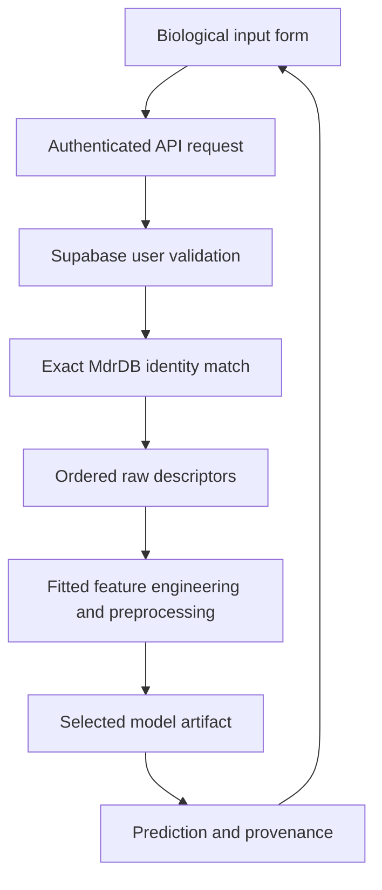

# Project guide

This repository separates the running application from the experiments and their outputs. Start here when explaining the code to a reviewer.

## Where to find things

| Area | Responsibility | Entry point |
| --- | --- | --- |
| Frontend routes | URL definitions, page metadata and page composition | [`index.tsx`](../frontend/src/routes/index.tsx) |
| Authentication UI | Login/signup and the active session hook | [`features/auth/`](../frontend/src/features/auth/) |
| Landing page | Hero illustration, headline and research scope | [`features/landing/`](../frontend/src/features/landing/) |
| Model catalog | Algorithms and feature tiers | [`features/catalog/`](../frontend/src/features/catalog/) |
| Dashboard | Shared live API state and evaluation tables | [`features/dashboard/`](../frontend/src/features/dashboard/) |
| Prediction UI | Authenticated biological and advanced descriptor consoles | [`features/prediction/`](../frontend/src/features/prediction/) |
| Shared UI | Layout, animation and reusable UI primitives | [`components/`](../frontend/src/components/) |
| Backend API | HTTP routes and authentication boundary | [`main.py`](../backend/app/main.py) |
| Backend schemas | Input validation and response contracts | [`schemas/`](../backend/app/schemas/) |
| Inference services | Identity resolution, ordered inputs and model prediction | [`services/`](../backend/app/services/) |
| Offline training | Train, export, report and verify | [`training/`](../backend/training/) |
| Tests | Unit checks, API tests and notebook export integration | [`tests/`](../tests/) |

## Boundaries to preserve

- Routes compose feature components; Supabase-specific adapters stay in `integrations/supabase/`.
- Shared `components/ui/` primitives do not own scientific rules or model scores.
- `backend/app/` serves requests; `backend/training/` runs offline jobs. Training is not triggered by a prediction request.
- `data/raw/` is source data, `data/processed/` is derived training input, `models/` is the serving artifact registry, and `results/` contains experiment outputs.
- `backend.app.services.notebook_model.NotebookModel` is referenced by saved joblib objects. Changing this import path requires an artifact compatibility/migration plan. It remains stable here.
- Vercel's project root remains `frontend`. Existing Python module commands and artifact paths remain valid.

## Request flow



An absent exact match is an explicit unsupported-input response, not a fabricated descriptor vector. The experimental DDG is shown separately and never used as a predictor input.

## Daily workflow

Run from the repository root after installing dependencies:

```sh
python scripts/project.py doctor
python scripts/project.py backend
```

In another terminal:

```sh
python scripts/project.py frontend
```

Other commands: `test` runs pytest; `check` adds frontend type checks and deployment configuration tests; `build` creates the Vercel frontend output; `verify-models` runs real artifact parity checks with mocked auth. The runner selects the existing project `venv` when present. `doctor` reads no credential values and checks local file availability only.

## Adding work

| Change | Location | Required validation |
| --- | --- | --- |
| New screen or interaction | Appropriate frontend feature + route if needed | Typecheck/build; review the interaction |
| New API behavior | Route, schema, service | Integration test for the request and failures |
| Pure preprocessing logic | Inference service | Unit test and notebook/artifact parity |
| New trained model | Offline training + full artifact set | Held-out metrics, metadata hashes, export parity |

Generated folders (`venv`, `node_modules`, `__pycache__`, `.pytest_cache`, `.vercel`) are local tools/build output, not application source. Do not include them in the repository or presentation walkthrough.

## Dependencies and tests

The single root `requirements.txt` lists all Python dependencies directly, grouped by API/inference, notebook training, and tests. There are no separate requirements files inside `backend/` or `backend/app/`.

From the repository root in a Python 3.13.12 virtual environment:

```sh
python -m pip install -r requirements.txt
python scripts/project.py check
```

This installs the same complete environment locally and on Render. Direct dependency versions preserve the recorded practical-v1 environment; transitive packages are not fully locked. The frontend independently uses `frontend/package.json` and its npm lockfile.

The backend runs directly from the checkout. Start it from the repository root with `python -m uvicorn backend.app.main:app`. Model and dataset paths remain relative to that source tree. Root `pytest.ini` contains test discovery and import-path settings.

Authentication configuration notes live in the [backend guide](../backend/README.md#login-and-signup) and [deployment guide](DEPLOYMENT.md#4-configure-supabase-auth-and-cors). The optional public-settings helper lives at `scripts/configure_supabase.py`; it is a setup command, not an API module.

Deployment configuration follows the same boundaries: root `render.yaml` and `.python-version` configure the Python service; `frontend/vercel.json` configures the web application. Keep Render at the repository root and Vercel at `frontend/`.

## Data ownership

- `raw/`: source MdrDB CSV. Preserve the original data and its hash; do not edit it to improve a prediction.
- `processed/`: generated numeric feature tiers and target for training.
- `sample/`: small numeric input examples for demonstration.

Large raw/processed CSVs use Git LFS. The biological console retrieves exact-record descriptors from the raw CSV. User accounts belong to Supabase Auth, not these files. See the [methodology](../results/final/model_evaluation.md) and [asset guide](GITHUB.md).

## Serving artifact registry

Each algorithm contains `model_A/`, `model_B/`, and `model_C/` slots. A complete export contains:

| File | Purpose |
| --- | --- |
| `model.joblib` | Trusted fitted estimator with preprocessing |
| `features.json` | Ordered raw input schema |
| `metadata.json` | Training profile, dataset/split hashes and preprocessing provenance |
| `metrics.json` | Measured evaluation scores used by the dashboard |
| `sample_input.json` | Exported input example |

LR/DT/RF artifacts are available; XGBoost slots are pending. Joblib files use Git LFS. Keep the entire export consistent and retain the Python class path used in serialization. Use [export.py](../backend/training/export.py) and `python -m backend.training.verify` to validate inference parity. Never load untrusted joblib files.

## Research notebooks

Numbered directories identify the analysis and algorithm tracks. The uploaded LR, DT and RF notebooks are the experiment sources. XGBoost is awaiting its notebook/export.

Application-serving code lives in `backend/app/`. Reusable training/export commands live in `backend/training/`. Executed notebook outputs go to `results/executed_notebooks/` when the full runner is used. Keep source notebooks separate from generated execution artifacts. See the [training guide](../backend/README.md).

## Experiment outputs

| Directory | Contents |
| --- | --- |
| `metrics/` | Per-algorithm exported scores |
| `predictions/` | Reference held-out predictions and residuals |
| `plots/` | Comparisons, residuals, feature importance and tree diagrams |
| `data_analysis/` | Data quality summaries and target distribution |
| `final/` | Consolidated comparison, evaluation report and API verification |
| `executed_notebooks/` (generated) | Executed full notebook runs |

`training_status.json` records the practical training run. The live application reads artifact-side `models/.../metrics.json`, so editing these reports alone does not update the dashboard. For presentation, use [model_evaluation.md](../results/final/model_evaluation.md) and [comparison plots](../results/plots/comparison). Preserve dataset/test-split hashes with all comparisons.

## Tests

- `unit/`: isolated preprocessing rules with small inputs.
- `integration/`: API/authentication contracts, biological identity resolution, catalog updates, and notebook export compatibility using temporary artifacts.
- `conftest.py`: shared fixtures; auth overrides are scoped to individual tests.

Run `python scripts/project.py test` from the repository root, or `python -m pytest tests -q` in the project environment. Root `pytest.ini` supplies a consistent repository import path.

The separate `python -m backend.training.verify` command checks real saved model predictions; it requires the artifacts and reference prediction files and mocks successful Supabase validation. Neither fixture tests nor this command establish independent scientific accuracy or verify a live user's login.
